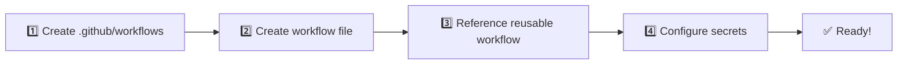

<div align="center">

# 🔄 Reusable CI Workflows for Archetypes MAPFRE

### Reusable GitHub Actions Workflows for MAPFRE Engineering Platform

[](https://github.com/features/actions)
[](https://yaml.org/)
[](LICENSE)

<p align="center">
  <b>Standardized CI/CD pipelines for consistent build, test, and deployment processes</b>
</p>

---


</div>

---


## 🖥️ About This Repository

This repository serves as the **central hub for reusable GitHub Actions workflows** within the MAPFRE RAM (Reference Architecture Model) platform. It provides pre-configured, battle-tested CI/CD pipelines that teams can easily integrate into their projects, ensuring:

- **Consistency**: All projects follow the same build, test, and deployment standards
- **Efficiency**: No need to reinvent the wheel — just reference and customize
- **Quality**: Built-in code quality checks with SonarQube integration
- **Multi-technology support**: Java, Node.js, Python/Django, databases, APIs, and more

By centralizing workflow definitions, we reduce duplication, simplify maintenance, and accelerate the onboarding of new projects across the organization.

---

## 📋 Table of Contents

- [🖥️ About This Repository](#️-about-this-repository)
- [✨ Features](#-features)
- [📑 Available Workflows](#-available-workflows)
- [🚀 Quick Start](#-quick-start)
- [📁 Repository Structure](#-repository-structure)
- [📖 Detailed Workflow Documentation](#-detailed-workflow-documentation)
- [🤝 Contributing](#-contributing)
- [📞 Support](#-support)

---

## ✨ Features

| Feature | Description |
|---------|-------------|
| 🔁 **Reusable Workflows** | DRY principle applied to CI/CD - write once, use everywhere |
| 🛡️ **Schema Validation** | JSON and YAML schemas for configuration validation |
| 📦 **Multi-Platform** | Support for Java, Node.js, Python/Django, and more |
| 🔍 **Code Quality** | Integrated SonarQube analysis for all workflows |
| 🐳 **Container Ready** | Built-in Docker image building and ACR publishing |
| 📊 **Artifact Management** | Automatic versioning and Azure Artifacts publishing |
| 🏪 **Marketplace Integration** | API and EDA publishing to MAPFRE Marketplace |

---

## 📑 Available Workflows

### 🐳 Container Workflows

| Workflow | Description | Technology |
|----------|-------------|------------|
| [`container.java.merge-commit.yml`](#containerjavamerge-commityml) | Java container merge workflow |  |
| [`container.java.pull-request.yml`](#containerjavapull-requestyml) | Java container PR workflow |  |
| [`container.node.merge-commit.yml`](#containernodemerge-commityml) | Node.js container merge workflow |  |
| [`container.node.pull-request.yml`](#containernodepull-requestyml) | Node.js container PR workflow |  |
| [`container.django.merge-commit.yml`](#containerdjanogomerge-commityml) | Django container merge workflow |  |
| [`container.django.pull-request.yml`](#containerdjanogopull-requestyml) | Django container PR workflow |  |
| [`container.gaia.merge-commit.yml`](#containergaiamerge-commityml) | GAIA container merge workflow |  |
| [`container.gaia.pull-request.yml`](#containergaiapull-requestyml) | GAIA container PR workflow |  |
| [`container.python.agent.merge-commit.yml`](#-python-archetype-variants-agent-and-mcp) | AI agent archetype: generic Python + agent security check |  |
| [`container.python.agent.pull-request.yml`](#-python-archetype-variants-agent-and-mcp) | AI agent archetype: generic Python + agent security check |  |
| [`container.python.mcp.merge-commit.yml`](#-python-archetype-variants-agent-and-mcp) | MCP server archetype: generic Python + contract manifest gate |  |
| [`container.python.mcp.pull-request.yml`](#-python-archetype-variants-agent-and-mcp) | MCP server archetype: generic Python + contract manifest gate |  |

### 📚 Library Workflows

| Workflow | Description | Technology |
|----------|-------------|------------|
| [`lib.java.merge-commit.yml`](#libjavamerge-commityml) | Java library merge workflow |  |
| [`lib.java.pull-request.yml`](#libjavapull-requestyml) | Java library PR workflow |  |
| [`lib.django.merge-commit.yml`](#libdjanogomerge-commityml) | Django library merge workflow |  |
| [`lib.django.pull-request.yml`](#libdjanogopull-requestyml) | Django library PR workflow |  |

### 🌐 API & Event-Driven Workflows

| Workflow | Description | Type |
|----------|-------------|------|
| [`api.merge-commit.yml`](#apimerge-commityml) | API merge workflow |  |
| [`api.pull-request.yml`](#apipull-requestyml) | API PR workflow |  |
| [`eda.merge-commit.yml`](#edamerge-commityml) | Event-Driven Architecture merge workflow |  |
| [`eda.pull-request.yml`](#edapull-requestyml) | Event-Driven Architecture PR workflow |  |

### 🗄️ Database Workflows

| Workflow | Description | Type |
|----------|-------------|------|
| [`db.relational.merge-commit.yml`](#dbrelationalmerge-commityml) | Relational DB merge workflow |  |
| [`db.relational.pull-request.yml`](#dbrelationalpull-requestyml) | Relational DB PR workflow |  |
| [`db.nosql.mongo.merge-commit.yml`](#dbnosqlmongomerge-commityml) | MongoDB merge workflow |  |
| [`db.nosql.mongo.pull-request.yml`](#dbnosqlmongopull-requestyml) | MongoDB PR workflow |  |

### 🖥️ Frontend & Batch Workflows

| Workflow | Description | Type |
|----------|-------------|------|
| [`frontend.spa.merge-commit.yml`](#frontendspa-merge-commityml) | SPA frontend merge workflow |  |
| [`frontend.spa.pull-request.yml`](#frontendspapull-requestyml) | SPA frontend PR workflow |  |
| [`batch.airflow.merge-commit.yml`](#batchairflowmerge-commityml) | Airflow batch merge workflow |  |
| [`batch.airflow.pull-request.yml`](#batchairflowpull-requestyml) | Airflow batch PR workflow |  |

### 🔧 Other Workflows

| Workflow | Description |
|----------|-------------|
| [`gaia.merge-commit.yml`](#gaiamerge-commityml) | GAIA merge workflow |
| [`gaia.pull-request.yml`](#gaiapull-requestyml) | GAIA PR workflow |
| [`mainframe.merge-commit.yml`](#mainframemerge-commityml) | Mainframe merge workflow |
| [`mainframe.pull-request.yml`](#mainframepull-requestyml) | Mainframe PR workflow |
| [`files.merge-commit.yml`](#filesmerge-commityml) | Files merge workflow |
| [`files.pull-request.yml`](#filespull-requestyml) | Files PR workflow |

---

## 📁 Repository Structure

<details>
<summary><b>📂 Click to expand file structure</b></summary>

```
📦 arch-ram-reusable-workflows
├── 📂 .github/
│   ├── 📂 ISSUE_TEMPLATE/
│   │   ├── 🐛 BUG_REPORT.yml
│   │   ├── 💻 CODE_CONTRIB.yml
│   │   ├── 📝 DOCUMENTATION_CONTRIB.yml
│   │   └── ✨ FEATURE_REQUEST.yml
│   └── 📂 workflows/
│       ├── 🔄 api.merge-commit.yml
│       ├── 🔄 api.pull-request.yml
│       ├── 🔄 batch.airflow.merge-commit.yml
│       ├── 🔄 batch.airflow.pull-request.yml
│       ├── 🔄 container.*.yml (Java, Node, Django, GAIA)
│       ├── 🔄 db.*.yml (Relational, MongoDB)
│       ├── 🔄 eda.*.yml (Event-Driven Architecture)
│       ├── 🔄 files.*.yml
│       ├── 🔄 frontend.spa.*.yml
│       ├── 🔄 gaia.*.yml
│       ├── 🔄 lib.*.yml (Java, Django)
│       ├── 🔄 mainframe.*.yml
│       ├── 📤 publish.yml
│       └── ✅ validate-workflow.yml
├── 📂 json-schemas/
│   └── 📄 *.project-manifest.schema.json
├── 📂 workflow-schemas/
│   └── 📄 *.schema.yml
├── 📋 CHANGELOG.md
├── 🤝 CONTRIBUTING.md
├── 📖 README.md
├── 🔧 renovate.json
└── 🏷️ version.txt
```

</details>

### 📁 Key Directories

| Directory | Description | Purpose |
|-----------|-------------|---------||
| `.github/workflows/` | 🔄 Reusable workflows | Contains all GitHub Actions workflows |
| `json-schemas/` | 📋 JSON Schemas | Validates project manifest files |
| `workflow-schemas/` | 📋 YAML Schemas | Validates workflow configurations |
| `.github/ISSUE_TEMPLATE/` | 📝 Issue Templates | Standardized issue creation |

---

## 🚀 Quick Start

### 📋 Step-by-step Setup



<details>
<summary><b>📋 Detailed Instructions</b></summary>

1. **Create** a `.github/workflows` directory in your repository
2. **Create** a workflow file (e.g., `pull-request.yml`)
3. **Reference** the reusable workflow using the `uses` keyword
4. **Configure** required secrets in your repository settings

</details>

### 💡 Example Usage

```yaml
name: Pull Request Workflow
on:
  pull_request:
    branches: [develop, main]

jobs:
  build-and-test:
    uses: mapfre-tech/arch-ram-reusable-workflows/.github/workflows/container.java.pull-request.yml@v1
    with:
      sonar-project-key: 'YOUR_PROJECT_KEY'
      sonar-project-name: 'YOUR_PROJECT_NAME'
    secrets:
      AZURE_ARTIFACTS_USER: ${{ secrets.AZURE_ARTIFACTS_USER }}
      AZURE_ARTIFACTS_PW: ${{ secrets.AZURE_ARTIFACTS_PW }}
      SONAR_TOKEN: ${{ secrets.SONAR_TOKEN }}
      GH_GIT_TOKEN: ${{ secrets.GH_GIT_TOKEN }}
```

> 💡 **Tip**: Replace `YOUR_PROJECT_KEY` and `YOUR_PROJECT_NAME` with your actual SonarQube project identifiers.

---

## 📜 Workflow Categories

### 🔀 Pull Request Workflows

> Triggered when a PR from `feature/*` → `develop` or `hotfix/*` → `main` is created/synchronized.

| Stage | Description |
|-------|-------------|
| ✅ Validation | Code validation and linting |
| 🔨 Build | Compilation and build |
| 🧪 Test | Unit testing |
| 🔍 Analysis | SonarQube code quality |
| 🐳 Container | Image building (without publishing) |

### 🔀 Merge Commit Workflows

> Triggered when a PR to `develop` or `main` is closed and merged.

| Stage | Description |
|-------|-------------|
| 📦 Artifacts | Build release/snapshot artifacts |
| 📤 Publish | Azure Artifacts or Container Registry |
| 🏷️ Tagging | Git release tags |
| 🔄 Next Version | Create next dev version PR |
| 🏪 Marketplace | API/EDA publishing |

---

## 📖 Detailed Workflow Documentation

<details open>
<summary><h3>🐳 Container Workflows</h3></summary>

---

### ☕ `container.java.merge-commit.yml`

 

> 🔄 Triggers when a pull request to `develop` or `main` is closed and merged.

#### 🔐 Required Secrets

| Secret Name           | Description                             | Scope         |
|-----------------------|-----------------------------------------|---------------|
| `AZURE_ARTIFACTS_USER`| User Azure Artifacts                    | Organization  |
| `AZURE_ARTIFACTS_PW`  | Password Azure Artifacts                | Organization  |
| `ACR_TOKEN_USER`      | User ACR                                | Organization  |
| `ACR_TOKEN_PW`        | Password ACR                            | Organization  |
| `RAM_GITHUB_GIT_TOKEN`| GitHub Token for creating Pull Request  | Repository    |

### Inputs ####

| Input Name                         | Description                          | Required | Type    | Default   |
|------------------------------------|--------------------------------------|----------|---------|-----------|
| `acr-folder`                       | ACR Folder                           | true     | string  |           |
| `java-version`                     | Java Version                         | false    | string  | '21'      |
| `java-extra-args`                  | Extra arguments for Java build       | false    | string  | '-Dsource.skip -DskipTests -Dcobertura.skip' |
| `jdk-distribution`                 | JDK Distribution                     | false    | string  | 'temurin' |
| `maven-version`                    | Maven Version                        | false    | string  | '3.9.6'   |
| `cache-enabled`                    | Cache Enabled                        | false    | boolean | true      |
| `source-folder`                    | Source Folder                        | false    | string  | 'sources' |
| `next-snapshot-create-pull-request`| Create Pull Request to develop       | false    | boolean | true      |
           


### Example Usage
```yaml
jobs:
  deploy:
    uses: mapfre-tech/arch-ram-reusable-workflows/container.java.merge-commit.yml@v1
    with:
      acr-folder: 'com/mapfre/ram/demo'
    secrets:
      AZURE_ARTIFACTS_USER: ${{secrets.AZURE_ARTIFACTS_USER}}
      AZURE_ARTIFACTS_PW: ${{secrets.AZURE_ARTIFACTS_PW}}
      ACR_TOKEN_USER: ${{ secrets.ACR_TOKEN_USER }}
      ACR_TOKEN_PW: ${{ secrets.ACR_TOKEN_PW }}
      RAM_GITHUB_GIT_TOKEN: ${{secrets.RAM_GITHUB_GIT_TOKEN}}
```

---

### ☕ `container.java.pull-request.yml`

 

> 🔄 Triggers when a pull request from `feature` → `develop` or `hotfix` → `main` is created/synchronized.

#### 🔐 Required Secrets

| Secret Name           | Description                             | Scope         |
|-----------------------|-----------------------------------------|---------------|
| `AZURE_ARTIFACTS_USER`| User Azure Artifacts                    | Organization  |
| `AZURE_ARTIFACTS_PW`  | Password Azure Artifacts                | Organization  |
| `ACR_TOKEN_USER`      | User ACR                                | Organization  |
| `ACR_TOKEN_PW`        | Password ACR                            | Organization  |
| `SONAR_TOKEN`         | Sonar Token                             | Repository    |
| `RAM_GITHUB_GIT_TOKEN`| GitHub Token for checking out the code  | Repository    |

### Inputs ####

| Input Name           | Description                          | Required | Type   | Default |
|----------------------|--------------------------------------|----------|--------|---------|
| `sonar-project-key`  | Sonar Project Key                    | false    | string | ''      |
| `sonar-project-name` | Sonar Project Name                   | false    | string | ''      |
| `sonar-host-url`     | Sonar url host                       | false    | string | 'https://codereview.azure.mapfre.com'      |
| `java-version`       | Java Version                         | false    | string | '21'      |
| `java-extra-args`    | Extra arguments for Java build       | false    | string | '-Dsource.skip -DskipTests -Dcobertura.skip' |
| `jdk-distribution`   | JDK Distribution                     | false    | string | 'temurin' |
| `maven-version`      | Maven Version                        | false    | string | '3.9.6'   |
| `cache-enabled`      | Cache Enabled                        | false    | boolean| true      |
| `source-folder`      | Source Folder                        | false    | string | 'sources' |


### Example Usage
```yaml
jobs:  
  pull-request:
    uses: mapfre-tech/arch-ram-reusable-workflows/.github/workflows/container.java.pull-request.yml@v1
    with:
      sonar-project-key: 'SCENARIO_XXXX'
      sonar-project-name: 'BIB_SCENARIO_XXXX'
    secrets:
      AZURE_ARTIFACTS_USER: ${{secrets.AZURE_ARTIFACTS_USER}}
      AZURE_ARTIFACTS_PW: ${{secrets.AZURE_ARTIFACTS_PW}}
      ACR_TOKEN_USER: ${{ secrets.ACR_TOKEN_USER }}
      ACR_TOKEN_PW: ${{ secrets.ACR_TOKEN_PW }}
      SONAR_TOKEN: ${{ secrets.SONAR_TOKEN }}
      GH_GIT_TOKEN: ${{ secrets.GH_GIT_TOKEN }}
```

---

### 🐍 `container.django.merge-commit.yml`

 

> 🔄 Triggers when a pull request to `develop` or `main` is closed and merged.

#### 🔐 Required Secrets

| Secret Name           | Description                             | Scope         |
|-----------------------|-----------------------------------------|---------------|
| `ACR_TOKEN_USER`      | User ACR                                | Organization  |
| `ACR_TOKEN_PW`        | Password ACR                            | Organization  |
| `RAM_GITHUB_GIT_TOKEN`| GitHub Token for creating Pull Request  | Repository    |

### Inputs ####

| Input Name                         | Description                          | Required | Type    | Default   |
|------------------------------------|--------------------------------------|----------|---------|-----------|
| `python-version`                   | Python version                       | false    | string  | '3.11'    |
| `poetry-version`                   | Poetry version                       | false    | string  | '2.1.1'   |
| `acr-folder`                       | ACR Folder                           | true     | string  |           |
| `source-folder`                    | Source Folder                        | false    | string  | 'sources' |


### Example Usage
```yaml
jobs:
  merge:
    uses: mapfre-tech/arch-ram-reusable-workflows/.github/workflows/container.django.merge-commit.yml@feature/AI-83
    with:      
      acr-folder: 'mapfre/arch/ram'
      source-folder: 'sources'
      poetry-version: '2.1.1'
      python-version: '3.11'
    secrets:
      ACR_TOKEN_USER: ${{ secrets.ACR_TOKEN_USER }}
      ACR_TOKEN_PW: ${{ secrets.ACR_TOKEN_PW }}
      RAM_GITHUB_GIT_TOKEN: ${{secrets.RAM_GITHUB_GIT_TOKEN}}
```

---

### 🐍 `container.django.pull-request.yml`

 

> 🔄 Triggers when a pull request from `feature` → `develop` or `hotfix` → `main` is created/synchronized.

#### 🔐 Required Secrets

| Secret Name           | Description                             | Scope         |
|-----------------------|-----------------------------------------|---------------|
| `ACR_TOKEN_USER`      | User ACR                                | Organization  |
| `ACR_TOKEN_PW`        | Password ACR                            | Organization  |
| `SONAR_TOKEN`         | Sonar Token                             | Repository    |
| `RAM_GITHUB_GIT_TOKEN`| GitHub Token for checking out the code  | Repository    |

### Inputs ####

| Input Name           | Description          | Required | Type   | Default |
|----------------------|----------------------|----------|--------|---------|
| `sonar-project-key`  | Sonar Project Key    | false    | string | ''      |
| `sonar-project-name` | Sonar Project Name   | false    | string | ''      |
| `python-version`     | Python version       | false    | string | '3.11'  |
| `poetry-version`     | Poetry version       | false    | string | '2.1.1' |
| `source-folder`      | Source Folder        | false    | string |'sources'|


### Example Usage
```yaml
jobs:
  pull-request:
    name: Build and Test
    uses: mapfre-tech/arch-ram-reusable-workflows/.github/workflows/container.django.pull-request.yml@feature/AI-83
    with:
      sonar-project-key: 'SCENARIO_XXXX'
      sonar-project-name: 'BIB_SCENARIO_XXXX'
      source-folder: 'sources'
      poetry-version: '2.1.1'
      python-version: '3.11'
    secrets:
      ACR_TOKEN_USER: ${{ secrets.ACR_TOKEN_USER }}
      ACR_TOKEN_PW: ${{ secrets.ACR_TOKEN_PW }}
      SONAR_TOKEN: ${{ secrets.SONAR_TOKEN }}
      RAM_GITHUB_GIT_TOKEN: ${{ secrets.RAM_GITHUB_GIT_TOKEN }}
```

---

### 🐍 Python archetype variants: agent and MCP

  

`container.python.agent.*` and `container.python.mcp.*` call the generic Python container
workflows (`container.python.pull-request.yml` / `container.python.merge-commit.yml`)
**unchanged**, behind one gate specific to each archetype. The generic pipeline — workflow
validation, tests with coverage, Sonar, image build, and on merge the push to ACR and the
release — only starts once the gate passes.

| Variant | Gate |
|---|---|
| agent | **Validate Agent Security Middlewares** — the agent registers `EntraIDAuthMiddleware` from `mapfre-agent-core` |
| mcp | **Validate MCP Contract Manifest** — `uv run python scripts/contract_sync.py --check` in `source-folder`: the manifest is exactly what the code generates and has no pending governance decision |

A project calls a variant exactly as it would call the generic:

- **Same inputs and secrets**, with the same defaults. There is nothing extra to pass.
- **Same layout**: `pyproject.toml`, the `app` package and its tests in `source-folder`
  (default `sources`), and `docker/Dockerfile` built from the repository root.
- **Same schema**: the generic validates the project's workflow file against
  `container.python.pull-request.schema.yml` / `container.python.merge-commit.schema.yml`.

The gate runs under the same conditions as the generic pipeline: `feature/` and `hotfix/` heads
on a pull request, and merged pull requests not headed by `release/branch--` on merge. The
generic runs one level deeper, so its check names gain a segment, e.g.
`Build and Test / Python / Build and Test`.

### Example Usage

The job names are part of the generic schema: `pull-request` for the pull request workflow,
and `merge` — with no `if:` and a `run-name` at the top — for the merge commit one.

```yaml
# .github/workflows/pull-request.yml
name: PR workflow
run-name: "Build and Test #${{ github.run_number }}: ${{ github.event.pull_request.title }}"
on:
  pull_request:
    types: [opened, synchronize]
    branches: [develop, main]
jobs:
  pull-request:
    name: Build and Test
    uses: mapfre-tech/arch-ram-reusable-workflows/.github/workflows/container.python.mcp.pull-request.yml@<ref>
    with:
      source-folder: 'sources'
    secrets:
      AZURE_ARTIFACTS_USER: ${{ secrets.AZURE_ARTIFACTS_USER }}
      AZURE_ARTIFACTS_PW: ${{ secrets.AZURE_ARTIFACTS_PW }}
      ACR_TOKEN_USER: ${{ secrets.ACR_TOKEN_USER }}
      ACR_TOKEN_PW: ${{ secrets.ACR_TOKEN_PW }}
      GH_TOKEN_ENCRYPTION_PASSPHRASE: ${{ secrets.GH_TOKEN_ENCRYPTION_PASSPHRASE }}
```

```yaml
# .github/workflows/merge-commit.yml
name: Merge Commit
run-name: "Generate ${{ (github.base_ref == 'main' || github.base_ref == 'master') && 'Release' || 'Snapshot' }} Artifact #${{ github.run_number }}"
on:
  pull_request:
    types: [closed]
    branches: [develop, main]
jobs:
  merge:
    uses: mapfre-tech/arch-ram-reusable-workflows/.github/workflows/container.python.mcp.merge-commit.yml@<ref>
    with:
      source-folder: 'sources'
    secrets:
      ACR_TOKEN_USER: ${{ secrets.ACR_TOKEN_USER }}
      ACR_TOKEN_PW: ${{ secrets.ACR_TOKEN_PW }}
      AZURE_ARTIFACTS_USER: ${{ secrets.AZURE_ARTIFACTS_USER }}
      AZURE_ARTIFACTS_PW: ${{ secrets.AZURE_ARTIFACTS_PW }}
      GH_TOKEN_ENCRYPTION_PASSPHRASE: ${{ secrets.GH_TOKEN_ENCRYPTION_PASSPHRASE }}
```

For the agent variant, change the file in `uses:`; the rest is the same.

---

### 🟢 `container.node.merge-commit.yml`

 

> 🔄 Triggers when a pull request to `develop` or `main` is closed and merged.

#### 🔐 Required Secrets

| Secret Name           | Description                             | Scope         |
|-----------------------|-----------------------------------------|---------------|
| `AZURE_ARTIFACTS_USER`| User Azure Artifacts                    | Organization  |
| `AZURE_ARTIFACTS_PW`  | Password Azure Artifacts                | Organization  |
| `ACR_TOKEN_USER`      | User ACR                                | Organization  |
| `ACR_TOKEN_PW`        | Password ACR                            | Organization  |
| `RAM_GITHUB_GIT_TOKEN`| GitHub Token for creating Pull Request  | Repository    |

### Inputs ####

| Input Name                         | Description                          | Required | Type    | Default   |
|------------------------------------|--------------------------------------|----------|---------|-----------|
| `acr-folder`                       | ACR Folder                           | true     | string  |           |
| `node-version`                     | Node.js Version                      | false    | string  | '22'      |
| `source-folder`                    | Source Folder                        | false    | string  | 'source/app' |
| `next-snapshot-create-pull-request`| Create Pull Request to develop       | false    | boolean | true      |

### Example Usage
```yaml
jobs:
  deploy:
    uses: mapfre-tech/arch-ram-reusable-workflows/container.node.merge-commit.yml@v1
    with:
      acr-folder: 'com/mapfre/ram/demo'
    secrets:
      AZURE_ARTIFACTS_USER: ${{secrets.AZURE_ARTIFACTS_USER}}
      AZURE_ARTIFACTS_PW: ${{secrets.AZURE_ARTIFACTS_PW}}
      ACR_TOKEN_USER: ${{ secrets.ACR_TOKEN_USER }}
      ACR_TOKEN_PW: ${{ secrets.ACR_TOKEN_PW }}
      RAM_GITHUB_GIT_TOKEN: ${{secrets.RAM_GITHUB_GIT_TOKEN}}
```

---

### 🟢 `container.node.pull-request.yml`

 

> 🔄 Triggers when a pull request from `feature` → `develop` or `hotfix` → `main` is created/synchronized.

#### 🔐 Required Secrets

| Secret Name           | Description                             | Scope         |
|-----------------------|-----------------------------------------|---------------|
| `AZURE_ARTIFACTS_USER`| User Azure Artifacts                    | Organization  |
| `AZURE_ARTIFACTS_PW`  | Password Azure Artifacts                | Organization  |
| `ACR_TOKEN_USER`      | User ACR                                | Organization  |
| `ACR_TOKEN_PW`        | Password ACR                            | Organization  |
| `SONAR_TOKEN`         | Sonar Token                             | Repository    |
| `RAM_GITHUB_GIT_TOKEN`| GitHub Token for checking out the code  | Repository    |

### Inputs ####

| Input Name           | Description          | Required | Type   | Default |
|----------------------|----------------------|----------|--------|---------|
| `sonar-project-key`  | Sonar Project Key    | false    | string | ''      |
| `sonar-project-name` | Sonar Project Name   | false    | string | ''      |
| `sonar-params`       | Sonar CLI Params     | false    | string | '-Dsonar.qualitygate.wait=false -Dsonar.sourceEncoding=UTF-8 -Dsonar.typescript.lcov.reportPaths=source/app/test/test-reports/coverage/lcov.info  -Dsonar.sources=docker,source'      |
| `node-version`       | Node.js Version      | false    | string | '22'    |
| `source-folder`      | Source Folder        | false    | string  | 'source/app' |

### Example Usage
```yaml
jobs:  
  pull-request:
    uses: mapfre-tech/arch-ram-reusable-workflows/.github/workflows/container.node.pull-request.yml@v1
    with:
      sonar-project-key: 'SCENARIO_XXXX'
      sonar-project-name: 'BIB_SCENARIO_XXXX'
    secrets:
      AZURE_ARTIFACTS_USER: ${{secrets.AZURE_ARTIFACTS_USER}}
      AZURE_ARTIFACTS_PW: ${{secrets.AZURE_ARTIFACTS_PW}}
      ACR_TOKEN_USER: ${{ secrets.ACR_TOKEN_USER }}
      ACR_TOKEN_PW: ${{ secrets.ACR_TOKEN_PW }}
      SONAR_TOKEN: ${{ secrets.SONAR_TOKEN }}
      GH_GIT_TOKEN: ${{ secrets.GH_GIT_TOKEN }}
```

</details>

<details open>
<summary><h3>📚 Library Workflows</h3></summary>

---

### 🐍 `lib.arch.django.merge-commit.yml`

 

> 🔄 Triggers when a pull request to `develop` or `main` is closed and merged for Django architecture libraries.
> 
> ✨ Features: automatic versioning, changelog generation via conventional-commits, packaging and publishing of release/snapshot versions.

#### 🔐 Required Secrets

| Secret Name                         | Description                                   | Scope         |
|-------------------------------------|-----------------------------------------------|---------------|
| `AZURE_ARTIFACTS_USER`              | User Azure Artifacts                          | Organization  |
| `AZURE_ARTIFACTS_PW`                | Password Azure Artifacts                      | Organization  |
| `RAM_GITHUB_GIT_TOKEN`              | GitHub Token para crear Pull Request          | Repository    |
| `APP_SEMANTIC_RELEASE_ID`           | App ID para Semantic Release (GitHub App)     | Repository    |
| `APP_SEMANTIC_RELEASE_PRIVATE_KEY`  | Private Key del GitHub App para releases      | Repository    |

### Inputs ####

| Input Name        | Description       | Required | Type   | Default |
|-------------------|-------------------|----------|--------|---------|
| `python-version`  | Python version    | false    | string | '3.11'  |
| `poetry-version`  | Poetry version    | false    | string | '2.1.1' |

### Example Usage
```yaml
jobs:
  merge:
    uses: mapfre-tech/arch-ram-reusable-workflows/.github/workflows/lib.arch.django.merge-commit.yml@feature/arch-libs-conventional-commits
    with:
      python_version: ${{ vars.PYTHON_VERSION }}
      poetry_version: ${{ vars.POETRY_VERSION }}
    secrets:
      AZURE_ARTIFACTS_USER: ${{ secrets.AZURE_ARTIFACTS_USER }}
      AZURE_ARTIFACTS_PW: ${{ secrets.AZURE_ARTIFACTS_PW }}
      APP_SEMANTIC_RELEASE_ID: ${{ secrets.APP_SEMANTIC_RELEASE_ID }}
      APP_SEMANTIC_RELEASE_PRIVATE_KEY: ${{ secrets.APP_SEMANTIC_RELEASE_PRIVATE_KEY }}
      RAM_GITHUB_GIT_TOKEN: ${{ secrets.RAM_GITHUB_GIT_TOKEN }}
```

</details>

<details open>
<summary><h3>🌐 API & Marketplace Workflows</h3></summary>

---

### 🌐 `api.merge-commit.yml`

 

> 🔄 Triggers when a pull request to `develop` or `main` is closed and merged.

#### 🔐 Required Secrets

| Secret Name           | Description                             | Scope         |
|-----------------------|-----------------------------------------|---------------|
| `AZURE_ARTIFACTS_USER`| User Azure Artifacts                    | Organization  |
| `AZURE_ARTIFACTS_PW`  | Password Azure Artifacts                | Organization  |
| `RAM_GITHUB_GIT_TOKEN`| GitHub Token for creating Pull Request  | Repository    |
| `OAUTH2_CLIENT_ID`    | Client ID     for Microsoft Login       | Repository    |
| `OAUTH2_CLIENT_SECRET`| Client Secret for Microsoft Login       | Repository    |

### Inputs ####

| Input Name                         | Description                              | Required | Type    | Default                              |
|------------------------------------|------------------------------------------|----------|---------|--------------------------------------|
| `manifest-file`                    | Manifest file                            | false    | string  | 'project-manifest.json'              |
| `marketplace-url`                  | Mapfre Marketplace URL                   | false    | string  | 'https://dev.marketplace.mapfre.com' |
| `next-snapshot-create-pull-request`| Create Pull Request to develop           | false    | boolean | true                                 |
           


### Example Usage

```yaml
jobs:
  deploy:
    uses: mapfre-tech/arch-ram-reusable-workflows/api.merge-commit.yml@v1
    with:
      marketplace-url: ${{ vars.MARKETPLACE_URL }}
    secrets:
      AZURE_ARTIFACTS_USER: ${{secrets.AZURE_ARTIFACTS_USER}}
      AZURE_ARTIFACTS_PW: ${{secrets.AZURE_ARTIFACTS_PW}}
      RAM_GITHUB_GIT_TOKEN: ${{secrets.RAM_GITHUB_GIT_TOKEN}}
      OAUTH2_CLIENT_ID: ${{secrets.RAM_GITHUB_GIT_TOKEN}}
      OAUTH2_CLIENT_SECRET: ${{secrets.OAUTH2_CLIENT_SECRET}}
```

---

### 🌐 `api.pull-request.yml`


> 🔄 Triggers when a pull request from `feature` → `develop` or `hotfix` → `main` is created/synchronized.

#### 🔐 Required Secrets

| Secret Name           | Description                             | Scope         |
|-----------------------|-----------------------------------------|---------------|
| `AZURE_ARTIFACTS_USER`| User Azure Artifacts                    | Organization  |
| `AZURE_ARTIFACTS_PW`  | Password Azure Artifacts                | Organization  |
| `GH_GIT_TOKEN`        | GitHub Token for checking out the code  | Repository    |

### Inputs ####

| Input Name           | Description          | Required | Type   | Default |
|----------------------|----------------------|----------|--------|---------|


### Example Usage
```yaml
jobs:  
  pull-request:
    uses: mapfre-tech/arch-ram-reusable-workflows/.github/workflows/api.pull-request.yml@v1
    secrets:
      AZURE_ARTIFACTS_USER: ${{secrets.AZURE_ARTIFACTS_USER}}
      AZURE_ARTIFACTS_PW: ${{secrets.AZURE_ARTIFACTS_PW}}
      GH_GIT_TOKEN: ${{ secrets.GH_GIT_TOKEN }}
```

</details>

<details open>
<summary><h3>🗄️ Database Workflows</h3></summary>

---

### 🗄️ `db.relational.pull-request.yml`

 

> 🔄 Triggers when a pull request from `feature` → `develop` or `hotfix` → `main` is created/synchronized.
>
> ✨ Validates database configurations, runs Liquibase commands, and performs code quality checks.

#### 🔐 Required Secrets

| Secret Name           | Description                             | Scope         |
|-----------------------|-----------------------------------------|---------------|
| `AZURE_ARTIFACTS_USER`| User Azure Artifacts                    | Organization  |
| `AZURE_ARTIFACTS_PW`  | Password Azure Artifacts                | Organization  |
| `SONAR_TOKEN`         | Sonar Token                             | Repository    |
| `GH_GIT_TOKEN`        | GitHub Token for checking out the code  | Repository    |

### Inputs ####

| Input Name           | Description                              | Required | Type    | Default                                   |
|----------------------|------------------------------------------|----------|---------|-------------------------------------------|
| `sonar-project-key`  | Sonar Project Key                        | false    | string  | ''                                        |
| `sonar-project-name` | Sonar Project Name                       | false    | string  | ''                                        |
| `sonar-host-url`     | Sonar Host URL                           | false    | string  | 'https://codereview.azure.mapfre.com'     |
| `sonar-params`       | Sonar scanner CLI params                 | false    | string  | '-Dsonar.qualitygate.wait=false -Dsonar.sourceEncoding=UTF-8 -Dsonar.sources=sources' |
| `runs-on-sonar`      | Runs-on configuration for Sonar job      | false    | string  | '["ubuntu-latest"]'                       |
| `manifest-file`      | Manifest file                            | false    | string  | 'project-manifest.json'                   |
| `log-level`          | Liquibase Log Level                      | false    | string  | 'INFO'                                    |
| `strict`             | Liquibase Strict Mode                   | false    | boolean | true                                      |

### Example Usage
```yaml
jobs:  
  pull-request:
    uses: mapfre-tech/arch-ram-reusable-workflows/.github/workflows/db.relational.pull-request.yml@v1
    with:
      sonar-project-key: 'SCENARIO_XXXX'
      sonar-project-name: 'BIB_SCENARIO_XXXX'
    secrets:
      AZURE_ARTIFACTS_USER: ${{ secrets.AZURE_ARTIFACTS_USER }}
      AZURE_ARTIFACTS_PW: ${{ secrets.AZURE_ARTIFACTS_PW }}
      SONAR_TOKEN: ${{ secrets.SONAR_TOKEN }}
      GH_GIT_TOKEN: ${{ secrets.GH_GIT_TOKEN }}
```

---

### 🗄️ `db.relational.merge-commit.yml`

 

> 🔄 Triggers when a pull request to `develop` or `main` is closed and merged.
>
> ✨ Handles the generation and publishing of release/snapshot artifacts for relational database projects.

#### 🔐 Required Secrets

| Secret Name           | Description                             | Scope         |
|-----------------------|-----------------------------------------|---------------|
| `AZURE_ARTIFACTS_USER`| User Azure Artifacts                    | Organization  |
| `AZURE_ARTIFACTS_PW`  | Password Azure Artifacts                | Organization  |
| `RAM_GITHUB_GIT_TOKEN`| GitHub Token for creating Pull Request  | Repository    |

### Inputs ####

| Input Name                         | Description                              | Required | Type    | Default                     |
|------------------------------------|------------------------------------------|----------|---------|-----------------------------|
| `next-snapshot-create-pull-request`| Create Pull Request to develop           | false    | boolean | true                        |
| `manifest-file`                    | Manifest file                            | false    | string  | 'project-manifest.json'     |
| `snapshot-format`                  | Snapshot version format ({0} = snapshot version, {1} = run_number)  | false    | string  | '{0}-{1}'                  |

### Example Usage
```yaml
jobs:
  merge-commit:
    uses: mapfre-tech/arch-ram-reusable-workflows/.github/workflows/db.relational.merge-commit.yml@v1   
    secrets:
      AZURE_ARTIFACTS_USER: ${{ secrets.AZURE_ARTIFACTS_USER }}
      AZURE_ARTIFACTS_PW: ${{ secrets.AZURE_ARTIFACTS_PW }}
      RAM_GITHUB_GIT_TOKEN: ${{ secrets.RAM_GITHUB_GIT_TOKEN }}
```

</details>

<details open>
<summary><h3>⚡ Event-Driven Architecture Workflows</h3></summary>

---

### ⚡ `eda.merge-commit.yml`

 

> 🔄 Triggers when a pull request to `develop` or `main` is closed and merged.
>
> ✨ Generates AsyncAPI documentation, packages event definitions, and publishes as snapshot/release artifacts.

#### 🔐 Required Secrets

| Secret Name            | Description                            | Scope        |
| ---------------------- | -------------------------------------- | ------------ |
| `AZURE_ARTIFACTS_USER` | User Azure Artifacts                   | Organization |
| `AZURE_ARTIFACTS_PW`   | Password Azure Artifacts               | Organization |
| `RAM_GITHUB_GIT_TOKEN` | GitHub Token for creating Pull Request | Repository   |
| `OAUTH2_CLIENT_ID`    | Client ID     for Microsoft Login       | Repository    |
| `OAUTH2_CLIENT_SECRET`| Client Secret for Microsoft Login       | Repository    |

### Inputs

| Input Name                         | Description                              | Required | Type    | Default                              |
|------------------------------------|------------------------------------------|----------|---------|--------------------------------------|
| `manifest-file`                    | Manifest file                            | false    | string  | 'project-manifest.json'              |
| `marketplace-url`                  | Mapfre Marketplace URL                   | false    | string  | 'https://dev.marketplace.mapfre.com' |
| `next-snapshot-create-pull-request`| Create Pull Request to develop           | false    | boolean | true                                 |

### Example Usage

```yaml
jobs:
  deploy:
    uses: mapfre-tech/arch-ram-reusable-workflows/.github/workflows/eda.merge-commit.yml@v1
    with:
      component_id: 'eda-events-billing'
    secrets:
      AZURE_ARTIFACTS_USER: ${{ secrets.AZURE_ARTIFACTS_USER }}
      AZURE_ARTIFACTS_PW: ${{ secrets.AZURE_ARTIFACTS_PW }}
      RAM_GITHUB_GIT_TOKEN: ${{ secrets.RAM_GITHUB_GIT_TOKEN }}
      OAUTH2_CLIENT_ID: ${{secrets.RAM_GITHUB_GIT_TOKEN}}
      OAUTH2_CLIENT_SECRET: ${{secrets.OAUTH2_CLIENT_SECRET}}
```

---

### ⚡ `eda.pull-request.yml`

 

> 🔄 Triggers when a pull request from `feature` → `develop` or `hotfix` → `main` is created/synchronized.
>
> ✨ Validates the structure and quality of AsyncAPI definitions using Spectral.

#### 🔐 Required Secrets

| Secret Name            | Description                            | Scope        |
| ---------------------- | -------------------------------------- | ------------ |
| `AZURE_ARTIFACTS_USER` | User Azure Artifacts                   | Organization |
| `AZURE_ARTIFACTS_PW`   | Password Azure Artifacts               | Organization |
| `RAM_GITHUB_GIT_TOKEN` | GitHub Token for checking out the code | Repository   |

### Inputs

| Input Name      | Description                               | Required | Type   | Default            |
| --------------- | ----------------------------------------- | -------- | ------ | ------------------ |


### Example Usage

```yaml
jobs:
  pull-request:
    uses: mapfre-tech/arch-ram-reusable-workflows/.github/workflows/eda.pull-request.yml@v1
    secrets:
      AZURE_ARTIFACTS_USER: ${{ secrets.AZURE_ARTIFACTS_USER }}
      AZURE_ARTIFACTS_PW: ${{ secrets.AZURE_ARTIFACTS_PW }}
      RAM_GITHUB_GIT_TOKEN: ${{ secrets.RAM_GITHUB_GIT_TOKEN }}
```

### Run AsyncAPI generation locally

You can generate the AsyncAPI documentation locally without needing to run the GitHub Action.

#### Requirements

Ensure you have the following dependency installed in your project:

```bash
npm install pee-pipehelper-modules
```

Also, if you're using `import` syntax, include this in your `package.json`:

```json
{
  "type": "module"
}
```

####  Script

Create a file `generate-asyncapi.js` at the root of your project with the following content:

```js
import fs from 'fs';
import path from 'path';
import { generateAsyncAPIFromEDA } from 'pee-pipehelper-modules';

const edaPath = './';
const eventsPath = './sources/events';
const outputPath = './output/asyncapi/events';
const globalOutputPath = './output/asyncapi/global';

const main = async () => {
  try {
    console.log('📄 Generating AsyncAPI per produced event...');
    const files = fs.readdirSync(eventsPath);

    for (const file of files) {
      const filePath = path.join(eventsPath, file);
      const eventData = JSON.parse(fs.readFileSync(filePath, 'utf8'));
      const eventName = eventData.name;

      if (eventName) {
        const eventOutputPath = path.join(outputPath, eventName);
        fs.mkdirSync(eventOutputPath, { recursive: true });
        await generateAsyncAPIFromEDA(edaPath, eventOutputPath, [eventName], 'producer');
        console.log(`✅ Generated AsyncAPI for produced event: ${eventName}`);
      }
    }

    console.log('🌐 Generating global AsyncAPI...');
    fs.mkdirSync(globalOutputPath, { recursive: true });
    await generateAsyncAPIFromEDA(edaPath, globalOutputPath);
    console.log('✅ Global AsyncAPI generated.');
  } catch (error) {
    console.error('❌ Error generating AsyncAPI documentation:', error.message);
    process.exit(1);
  }
};

main();
```

#### Run the script

To execute the script manually:

```bash
node generate-asyncapi.js
```

Or add this to your `package.json` scripts section:

```json
"scripts": {
  "generate:asyncapi": "node generate-asyncapi.js"
}
```

Then run it with:

```bash
npm run generate:asyncapi
```

---

### ☕ `lib.java.pull-request.yml`

 

> 🔄 Triggers when a pull request from `feature` → `develop` or `hotfix` → `main` is created/synchronized.
>
> ✨ Builds, tests, and validates Java library projects.

#### 🔐 Required Secrets

| Secret Name            | Description                            | Scope        |
| ---------------------- | -------------------------------------- | ------------ |
| `AZURE_ARTIFACTS_USER` | User Azure Artifacts                   | Organization |
| `AZURE_ARTIFACTS_PW`   | Password Azure Artifacts               | Organization |
| `SONAR_TOKEN`          | Sonar Token                            | Repository   |
| `GH_GIT_TOKEN`         | GitHub Token for checking out the code | Repository   |

### Inputs

| Input Name           | Description             | Required | Type    | Default                                              |
| -------------------- | ----------------------- | -------- | ------- | ---------------------------------------------------- |
| `sonar-project-key`  | Sonar Project Key       | false    | string  | ''                                                   |
| `sonar-project-name` | Sonar Project Name      | false    | string  | ''                                                   |
| `sonar-host-url`     | Sonar Host URL          | false    | string  | 'https://codereview.azure.mapfre.com'                |
| `java-version`       | Java Version            | false    | string  | '21'                                                 |
| `java-extra-args`    | Java Extra Args         | false    | string  | '-Dsource.skip -DskipTests -Dcobertura.skip'         |
| `jdk-distribution`   | JDK Distribution        | false    | string  | 'temurin'                                            |
| `maven-version`      | Maven Version           | false    | string  | '3.9.6'                                              |
| `cache-enabled`      | Cache Enabled           | false    | boolean | true                                                 |
| `source-folder`      | Source Folder           | false    | string  | 'sources'                                            |
| `runs-on-sonar`      | Runs-on for Sonar job   | false    | string  | '["ubuntu-latest"]'                                  |

### Example Usage

```yaml
jobs:
  pull-request:
    uses: mapfre-tech/arch-ram-reusable-workflows/.github/workflows/lib.java.pull-request.yml@v1
    with:
      sonar-project-key: 'LIB_EXAMPLE'
      sonar-project-name: 'Library Example'
    secrets:
      AZURE_ARTIFACTS_USER: ${{ secrets.AZURE_ARTIFACTS_USER }}
      AZURE_ARTIFACTS_PW: ${{ secrets.AZURE_ARTIFACTS_PW }}
      SONAR_TOKEN: ${{ secrets.SONAR_TOKEN }}
      GH_GIT_TOKEN: ${{ secrets.GH_GIT_TOKEN }}
```

---

### ☕ `lib.java.merge-commit.yml`

 

> 🔄 Triggers when a pull request to `develop` or `main` is closed and merged.
>
> ✨ Builds and publishes Java library artifacts to Azure Artifacts.

#### 🔐 Required Secrets

| Secret Name            | Description                             | Scope        |
| ---------------------- | --------------------------------------- | ------------ |
| `AZURE_ARTIFACTS_USER` | User Azure Artifacts                    | Organization |
| `AZURE_ARTIFACTS_PW`   | Password Azure Artifacts                | Organization |
| `RAM_GITHUB_GIT_TOKEN` | GitHub Token for creating Pull Request  | Repository   |

### Inputs

| Input Name                          | Description                      | Required | Type    | Default                                      |
| ----------------------------------- | -------------------------------- | -------- | ------- | -------------------------------------------- |
| `java-version`                      | Java Version                     | false    | string  | '21'                                         |
| `java-extra-args`                   | Java Extra Args                  | false    | string  | '-Dsource.skip -DskipTests -Dcobertura.skip' |
| `jdk-distribution`                  | JDK Distribution                 | false    | string  | 'temurin'                                    |
| `maven-version`                     | Maven Version                    | false    | string  | '3.9.6'                                      |
| `cache-enabled`                     | Cache Enabled                    | false    | boolean | true                                         |
| `source-folder`                     | Source Folder                    | false    | string  | 'sources'                                    |
| `next-snapshot-create-pull-request` | Create Pull Request to develop   | false    | boolean | true                                         |

### Example Usage

```yaml
jobs:
  merge:
    uses: mapfre-tech/arch-ram-reusable-workflows/.github/workflows/lib.java.merge-commit.yml@v1
    secrets:
      AZURE_ARTIFACTS_USER: ${{ secrets.AZURE_ARTIFACTS_USER }}
      AZURE_ARTIFACTS_PW: ${{ secrets.AZURE_ARTIFACTS_PW }}
      RAM_GITHUB_GIT_TOKEN: ${{ secrets.RAM_GITHUB_GIT_TOKEN }}
```

</details>

<details open>
<summary><h3>🖥️ Frontend & Other Workflows</h3></summary>

---

### 🌐 `frontend.spa.pull-request.yml`


> 🔄 Triggers when a pull request from `feature` → `develop` or `hotfix` → `main` is created/synchronized.
>
> ✨ Builds and tests Single Page Applications.

#### 🔐 Required Secrets

| Secret Name            | Description                            | Scope        |
| ---------------------- | -------------------------------------- | ------------ |
| `AZURE_ARTIFACTS_USER` | User Azure Artifacts                   | Organization |
| `AZURE_ARTIFACTS_PW`   | Password Azure Artifacts               | Organization |
| `GH_GIT_TOKEN`         | GitHub Token for checking out the code | Repository   |

### Example Usage

```yaml
jobs:
  pull-request:
    uses: mapfre-tech/arch-ram-reusable-workflows/.github/workflows/frontend.spa.pull-request.yml@v1
    secrets:
      AZURE_ARTIFACTS_USER: ${{ secrets.AZURE_ARTIFACTS_USER }}
      AZURE_ARTIFACTS_PW: ${{ secrets.AZURE_ARTIFACTS_PW }}
      GH_GIT_TOKEN: ${{ secrets.GH_GIT_TOKEN }}
```

---

### ✈️ `batch.airflow.pull-request.yml`


> 🔄 Triggers when a pull request from `feature` → `develop` or `hotfix` → `main` is created/synchronized.
>
> ✨ Validates Airflow DAG configurations.

#### 🔐 Required Secrets

| Secret Name            | Description                            | Scope        |
| ---------------------- | -------------------------------------- | ------------ |
| `GH_GIT_TOKEN`         | GitHub Token for checking out the code | Repository   |

### Example Usage

```yaml
jobs:
  pull-request:
    uses: mapfre-tech/arch-ram-reusable-workflows/.github/workflows/batch.airflow.pull-request.yml@v1
    secrets:
      GH_GIT_TOKEN: ${{ secrets.GH_GIT_TOKEN }}
```

---

### 💾 `mainframe.pull-request.yml`


> 🔄 Triggers when a pull request from `feature` → `develop` or `hotfix` → `main` is created/synchronized.
>
> ✨ Validates mainframe code and configurations.

#### 🔐 Required Secrets

| Secret Name    | Description                            | Scope      |
| -------------- | -------------------------------------- | ---------- |
| `GH_GIT_TOKEN` | GitHub Token for checking out the code | Repository |

### Example Usage

```yaml
jobs:
  pull-request:
    uses: mapfre-tech/arch-ram-reusable-workflows/.github/workflows/mainframe.pull-request.yml@v1
    secrets:
      GH_GIT_TOKEN: ${{ secrets.GH_GIT_TOKEN }}
```

---

### 📁 `files.pull-request.yml`


> 🔄 Triggers when a pull request from `feature` → `develop` or `hotfix` → `main` is created/synchronized.
>
> ✨ Validates generic file-based projects.

#### 🔐 Required Secrets

| Secret Name    | Description                            | Scope      |
| -------------- | -------------------------------------- | ---------- |
| `GH_GIT_TOKEN` | GitHub Token for checking out the code | Repository |

### Example Usage

```yaml
jobs:
  pull-request:
    uses: mapfre-tech/arch-ram-reusable-workflows/.github/workflows/files.pull-request.yml@v1
    secrets:
      GH_GIT_TOKEN: ${{ secrets.GH_GIT_TOKEN }}
```

</details>

---

## 🔧 Utility Workflows

<details>
<summary><b>ℹ️ Internal Workflows</b></summary>

| Workflow | Purpose |
|----------|---------|
| `validate-workflow.yml` | Validates configurations against schemas before execution |
| `publish.yml` | Publishing and versioning of the reusable workflows repository |

</details>

---

## 🤝 Contributing

<div align="center">

**We welcome contributions!** 🎉

</div>

Before contributing, please read our [**📋 Contribution Guide**](CONTRIBUTING.md) for detailed instructions on:

- 🐛 Reporting bugs
- ✨ Requesting features  
- 💻 Submitting code changes
- 📝 Improving documentation

### Branch Strategy

```
main ─────────────────────────────────────> Production
  │
  └── develop ───────────────────────────> Integration
        │
        ├── feature/* ───────────────────> New features
        │
        └── hotfix/* ────────────────────> Urgent fixes
```

---

## 📚 Additional Resources

| Resource | Description |
|----------|-------------|
| 📋 [CHANGELOG.md](CHANGELOG.md) | Complete history of changes and version releases |
| 🏷️ [version.txt](version.txt) | Current version of the reusable workflows |
| 🔄 [renovate.json](renovate.json) | Configuration for automated dependency updates |

---

## 📞 Support

<div align="center">

**Need help?** 🆘

</div>

| Issue Type | Template |
|------------|----------|
| 🐛 Bug Report | [BUG_REPORT.yml](.github/ISSUE_TEMPLATE/BUG_REPORT.yml) |
| ✨ Feature Request | [FEATURE_REQUEST.yml](.github/ISSUE_TEMPLATE/FEATURE_REQUEST.yml) |
| 💻 Code Contribution | [CODE_CONTRIB.yml](.github/ISSUE_TEMPLATE/CODE_CONTRIB.yml) |
| 📝 Documentation | [DOCUMENTATION_CONTRIB.yml](.github/ISSUE_TEMPLATE/DOCUMENTATION_CONTRIB.yml) |

---

<div align="center">

**Made with ❤️ by MAPFRE DevOps Platform**


</div>
